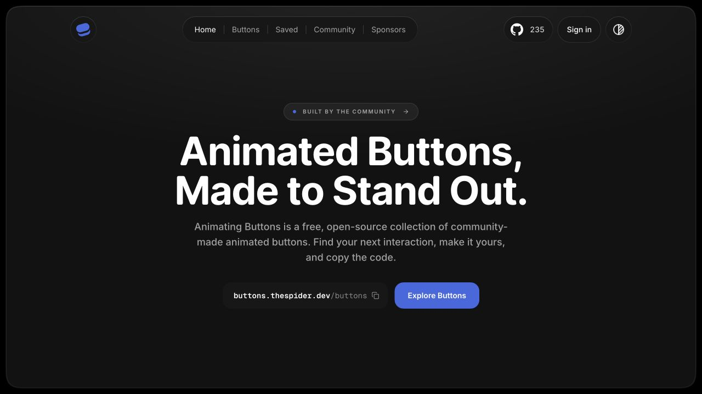

<div align="center">
  <a href="https://getbuttons.tech">
    
  </a>

  <h1>Animating Buttons</h1>

  <p><strong>An open-source collection of animated buttons made by the community.</strong></p>

  <p>
    <a href="https://getbuttons.tech/buttons">Browse buttons</a> ·
    <a href="https://getbuttons.tech/add">Submit a button</a> ·
    <a href="https://getbuttons.tech/sponsors">Sponsor</a> ·
    <a href="https://x.com/thespiderdev">Follow on X</a>
  </p>

<a href="LICENSE"></a>
<a href="https://github.com/thespiderdev/Animating-Buttons/stargazers"></a>
<a href="https://github.com/thespiderdev/Animating-Buttons/graphs/contributors"></a>

</div>

## Use a button

1. [Find a button](https://getbuttons.tech/buttons) and try the live preview.
2. Open its code or remix it in the workshop.
3. Copy the snippet or download its files into your project.

The catalogue includes HTML, CSS, Tailwind CSS v4, JavaScript, and React examples. React downloads include TSX and dependency information. The workshop supports keyboard and reduced-motion checks, local drafts, and standalone exports.

## Run locally

Use Node.js 22 or newer.

```sh
git clone https://github.com/thespiderdev/Animating-Buttons.git
cd Animating-Buttons
npm ci
cp .env.example .env.local
npm run dev
```

Open [localhost:3000](http://localhost:3000). Fill in your Firebase public settings in `.env.local`. Enable the GitHub provider and authorize your development hostname for sign-in and contributions.

Built with Next.js, TypeScript, Tailwind CSS, Motion, and Firebase.

## Contribute

- [Submit a button](https://getbuttons.tech/add) for community review.
- [Open an issue](https://github.com/thespiderdev/Animating-Buttons/issues/new/choose) for a bug or feature idea.
- Read the [contributing guide](CONTRIBUTING.md) before opening a pull request.

```sh
npm test
npm run typecheck
npm run lint
npm run build
```

## Project docs

- [Button workshop](docs/button-workshop.md)
- [Catalogue imports and creator credits](docs/button-imports.md)
- [Sponsorship operations](docs/sponsorships.md)
- [Search and site analytics](docs/seo.md)
- [Cloudflare deployment](docs/cloudflare.md)

## Sponsors

Sponsorship supports the catalogue and the workshop. [View monthly and lifetime plans](https://getbuttons.tech/sponsors).

## License

The application is released under the [MIT license](LICENSE). Imported examples carry their own [source notices and licenses](THIRD_PARTY_NOTICES.md).
